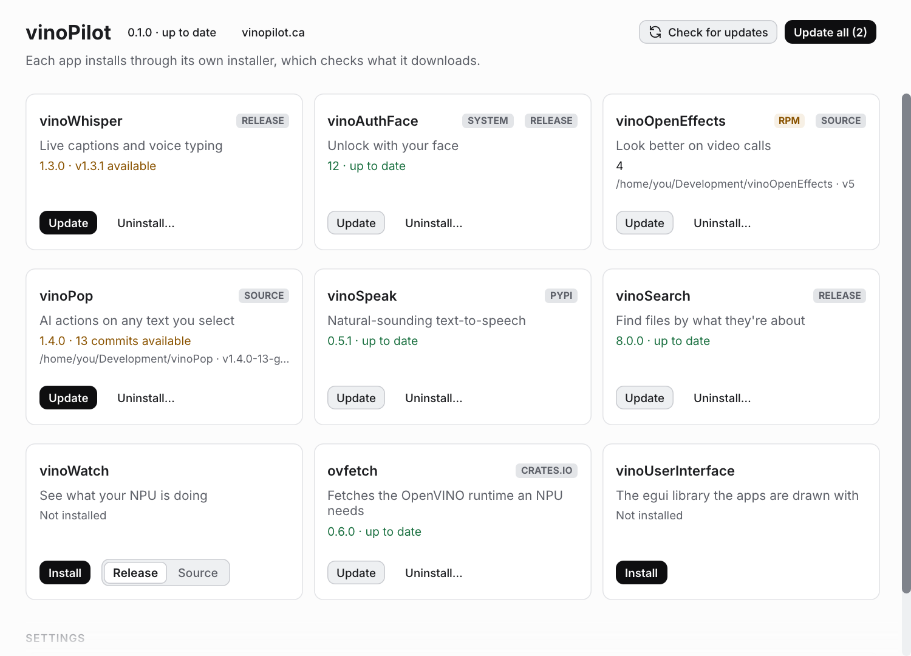

# vinoPilot

One place to install, update and uninstall the [vinoPilot](https://vinopilot.ca/) apps. Each app already has its own hash-checked installer. vinoPilot knows which one to run, how each app got onto your machine, and whether there's something newer for that way in.


## What it manages

| Component | Release | Source | Package |
|---|---|---|---|
| [vinoWhisper](https://github.com/karanshukla/vinoWhisper) | yes | yes | [PyPI](https://pypi.org/project/vinowhisper/) |
| [vinoAuthFace](https://github.com/karanshukla/vinoAuthFace) | yes (asks for your password) | yes | |
| [vinoOpenEffects](https://github.com/karanshukla/vinoOpenEffects) | yes | yes | |
| [vinoPop](https://github.com/karanshukla/vinoPop) | yes | yes | |
| [vinoSpeak](https://github.com/karanshukla/vinoSpeak) | yes | yes | [PyPI](https://pypi.org/project/vinospeak/) |
| [vinoSearch](https://github.com/karanshukla/vinoSearch) | yes, or its Flatpak | yes | |
| [vinoWatch](https://github.com/karanshukla/vinoWatch) | yes | yes | |
| [ovfetch](https://github.com/karanshukla/ovfetch) | yes | yes | [crates.io](https://crates.io/crates/ovfetch) |
| [vinoUserInterface](https://github.com/karanshukla/vinoUserInterface) | | a checkout that builds | a library, nothing to install |
| vinoPilot itself | yes | yes | [crates.io](https://crates.io/crates/vinopilot) |

- **Release**: the app's own one-line installer from its latest GitHub release, checked against the release's `SHA256SUMS`.
- **Source**: a clone in your source folder, installed with the checkout's own script.
- **Package**: `uv tool` for PyPI, `cargo install` for crates.io.

vinoPilot keeps no records of its own. It works out how each app is installed by looking, so it also sees apps you installed by hand. Nothing goes online until you press **Check for updates** or run `vinopilot check`. [docs/how-it-works.md](docs/how-it-works.md) has the detail on each way in, detection and the limits.

## Install

Download the Flatpak, the .deb or the .rpm from the [latest release](https://github.com/karanshukla/vinopilot/releases/latest). Each holds `vinopilot` (the command) and `vinopilot-gui` (the window), and adds vinoPilot to your app menu.

```sh
# Flatpak: any distro, including rpm-ostree ones (Silverblue, Kinoite, Bazzite)
curl -fsSLO https://github.com/karanshukla/vinopilot/releases/latest/download/vinopilot-x86_64.flatpak
flatpak install --user ./vinopilot-x86_64.flatpak

# Debian, Ubuntu, Mint
curl -fsSLO https://github.com/karanshukla/vinopilot/releases/latest/download/vinopilot-x86_64.deb
sudo apt install ./vinopilot-x86_64.deb

# Fedora
sudo dnf install https://github.com/karanshukla/vinopilot/releases/latest/download/vinopilot-x86_64.rpm
```

x86_64 only for the release binaries, same as the apps it installs.

[docs/install.md](docs/install.md) covers the one-line installer (no sudo), crates.io, a checkout, what the Flatpak is allowed to do, and updating or uninstalling vinoPilot itself.

## The window

Nine cards, three by three: the seven apps, ovfetch and vinoUserInterface. Each has its version, how it's installed, and **Update** or **Install**. Before installing, the switch on the card picks the way in. The installer's output streams into a panel underneath, with **Stop**.

- **Update all** appears once a check finds something.
- vinoPilot's own version is a button in the header. It checks for a newer vinoPilot, updates to it, then restarts into it.
- vinoAuthFace installs system-wide, so its actions go through `pkexec` and ask for your password.

It follows the desktop's light or dark setting, and drops to one column when three don't fit, like when snapped to half a laptop screen:

<p align="center">
  
  
</p>

## The command

```sh
vinopilot list                    # what's installed, and how (offline)
vinopilot check                   # plus the newest version of each (online)
vinopilot install whisper --via pypi
vinopilot update --all
vinopilot uninstall pop
vinopilot steps search install    # print the shell an action would run, without running it
```

App names work with or without the `vino`. `--via` takes `release` (the default), `source`, `pypi` or `crates`, and `flatpak` for vinoSearch. Exit codes: 0 done, 1 failed, 2 bad usage.

`--json` turns it into an API: `list` and `check` print one document, and actions print one event per line. A frontend in another language should drive that instead of reimplementing the catalog. [docs/json-api.md](docs/json-api.md) has the shape.

There's a terminal UI too, a thin [Textual](https://textual.textualize.io/) frontend over `vinopilot --json`: `uv tool install vinopilot`, then `vinopilot-tui`. See [tui/README.md](tui/README.md).

## Limits

- **Uninstalling an app removes its downloaded models** and keeps your own data and settings. Each app's own uninstaller decides what that covers.
- **Uninstalling a source install moves its checkout to the trash**, unless it holds work that's nowhere else.
- **Detection is a best guess for hand installs.**
- Installers get no terminal, so each runs with its non-interactive defaults.

The full list is in [docs/how-it-works.md](docs/how-it-works.md#limits).

## Layout

| Path | What |
|---|---|
| `crates/core` | `vinopilot-core`: the catalog (each app's install, update and uninstall steps per way in), detection, version checks, the job runner. No UI. |
| `crates/cli` | `vinopilot`: the command, and the `--json` API |
| `crates/gui` | `vinopilot-gui`: the egui window, drawn with [vinoUserInterface](https://github.com/karanshukla/vinoUserInterface) |
| `tui/` | `vinopilot-tui`: the same in a terminal, from PyPI |
| `install.sh` | the one-line installer, and the source install from a checkout |
| `packaging/` | what the .deb, the .rpm and the Flatpak add around the release's binaries |

[vinopilot.ca](https://vinopilot.ca/) has the apps themselves. Issues and PRs welcome, see [CONTRIBUTING.md](CONTRIBUTING.md).
