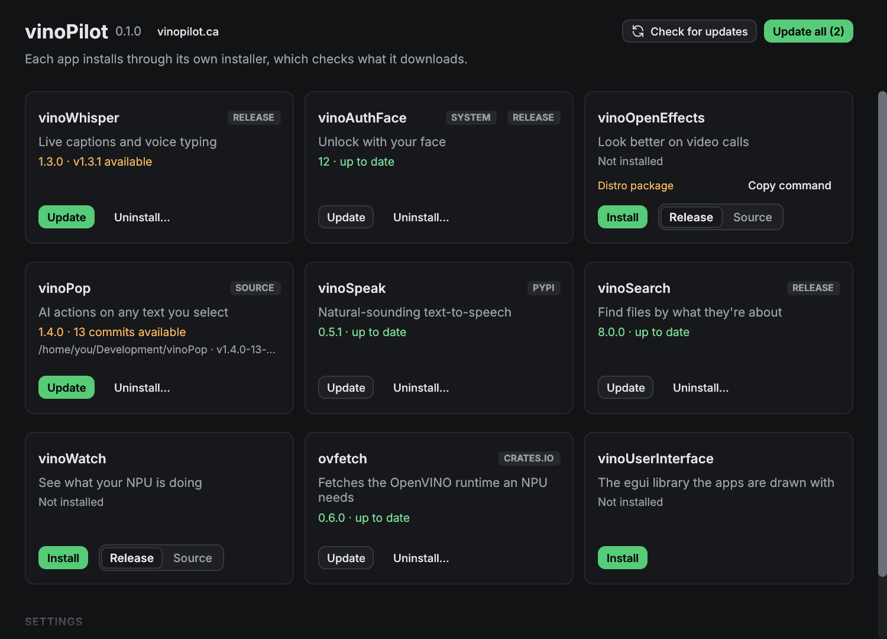
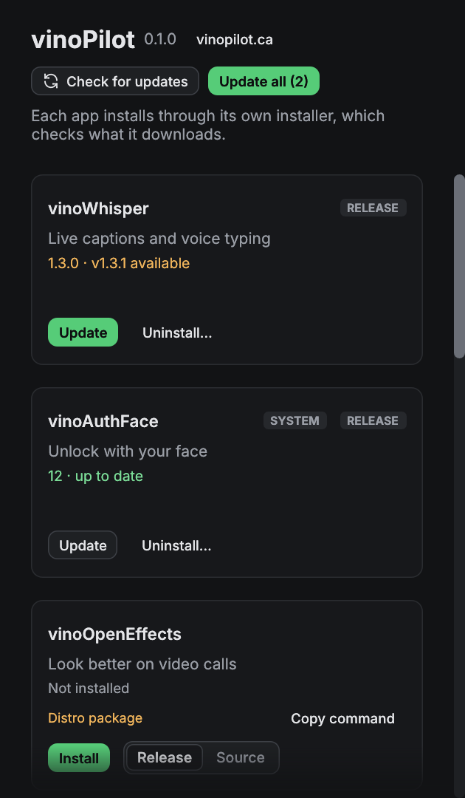

# vinoPilot

A single tool to install, update, and uninstall the [vinoPilot](https://vinopilot.ca/) apps. Each app already ships its own checksum-verified installer; `vinoPilot` tracks how each app was installed on your system, checks for newer versions from that source, and invokes the matching installer.



## Managed components

| Component | Release | Source | Package |
|---|---|---|---|
| [vinoWhisper](https://github.com/karanshukla/vinoWhisper) | Yes, or Flatpak | Yes | [PyPI](https://pypi.org/project/vinowhisper/) |
| [vinoAuthFace](https://github.com/karanshukla/vinoAuthFace) | Yes (prompts for password) | Yes | |
| [vinoOpenEffects](https://github.com/karanshukla/vinoOpenEffects) | Yes | Yes | |
| [vinoPop](https://github.com/karanshukla/vinoPop) | Yes | Yes | |
| [vinoSpeak](https://github.com/karanshukla/vinoSpeak) | Yes | Yes | [PyPI](https://pypi.org/project/vinospeak/) |
| [vinoSearch](https://github.com/karanshukla/vinoSearch) | Yes, or Flatpak | Yes | |
| [vinoWatch](https://github.com/karanshukla/vinoWatch) | Yes | Yes | |
| [ovfetch](https://github.com/karanshukla/ovfetch) | Yes | Yes | [crates.io](https://crates.io/crates/ovfetch) |
| [vinoUserInterface](https://github.com/karanshukla/vinoUserInterface) | | Git checkout that builds | Library (nothing installed) |
| vinoPilot itself | Yes | Yes | [crates.io](https://crates.io/crates/vinopilot) |

- **Release:** Runs the app's official one-line installer from its latest GitHub release and verifies downloads against `SHA256SUMS`.
- **Source:** Clones the repository into your source directory and runs the checkout's install script.
- **Package:** Installs via `uv tool` (for PyPI) or `cargo install` (for crates.io).

`vinoPilot` does not maintain a private database of installed apps. Instead, it detects existing installations directly on your system, so apps you installed manually are also recognized. It stays offline until you click **Check for updates** or run `vinopilot check`. See [docs/how-it-works.md](docs/how-it-works.md) for details on install methods, detection, and limitations.

## Install

Download the Flatpak, `.deb`, or `.rpm` from the [latest release](https://github.com/karanshukla/vinopilot/releases/latest). Every package includes both `vinopilot` (the CLI) and `vinopilot-gui` (the desktop window) and adds vinoPilot to your application menu.

```sh
# Flatpak (any distro, including rpm-ostree systems like Silverblue, Kinoite, and Bazzite)
curl -fsSLO https://github.com/karanshukla/vinopilot/releases/latest/download/vinopilot-x86_64.flatpak
flatpak install --user ./vinopilot-x86_64.flatpak

# Debian, Ubuntu, Mint
curl -fsSLO https://github.com/karanshukla/vinopilot/releases/latest/download/vinopilot-x86_64.deb
sudo apt install ./vinopilot-x86_64.deb

# Fedora
sudo dnf install https://github.com/karanshukla/vinopilot/releases/latest/download/vinopilot-x86_64.rpm
```

Prebuilt release binaries are provided for Linux `x86_64` only, matching the apps `vinoPilot` manages.

See [docs/install.md](docs/install.md) for the non-root one-line installer, crates.io, building from a Git checkout, Flatpak host permissions, and self-updating or uninstalling `vinoPilot`.

## Desktop window

The GUI displays a 3×3 grid of nine cards covering the seven apps, `ovfetch`, and `vinoUserInterface`. Each card shows its installed version, install method, and an **Update** or **Install** button. Before installing an app, use the card's selector to choose the install method. Installer output streams into a panel at the bottom with a **Stop** button.

- **Update all** appears once an update check finds available updates.
- Click vinoPilot's version button in the header to check for a newer release, update vinoPilot, and restart into the new version.
- `vinoAuthFace` installs system-wide, so its actions run via `pkexec` and prompt for your password.

The window follows your desktop's light or dark theme and automatically switches to a single column when three columns do not fit (for example, when tiled to half a laptop screen):

<p align="center">
  
  
</p>

## Command line

```sh
vinopilot list                    # show installed apps and install methods (offline)
vinopilot check                   # also query the newest version of each app (online)
vinopilot install whisper --via pypi
vinopilot update --all
vinopilot uninstall pop
vinopilot steps search install    # print the shell script an action would run without executing it
```

- App names work with or without the `vino` prefix.
- `--via` accepts `release` (default), `source`, `pypi`, `crates`, and `flatpak` (for `vinoWhisper` and `vinoSearch`).
- **Exit codes:** `0` succeeded, `1` failed, `2` invalid CLI usage.
- Options can appear anywhere on the command line. Short flags can be combined (`-yh`), `--` ends option parsing, and passing a value to a flag that takes none (such as `--json=x`) is rejected.

Passing `--json` exposes a machine-readable API: `list` and `check` output a single JSON document, while install/update/uninstall actions stream one JSON event per line. Frontends in other languages can drive `vinopilot --json` directly instead of reimplementing the catalog. See [docs/json-api.md](docs/json-api.md) for the schema.

A terminal UI is also available as a lightweight [Textual](https://textual.textualize.io/) frontend over `vinopilot --json`: install with `uv tool install vinopilot` and run `vinopilot-tui`. See [tui/README.md](tui/README.md).

## Limitations

- **Uninstalling an app deletes its downloaded models** while keeping user data and settings. Each app's own uninstaller defines what is removed.
- **Uninstalling a source install moves its checkout to the trash**, unless the repository contains uncommitted, unpushed, or stashed work.
- **Detection for manually installed apps is best-effort.**
- Installers run without an interactive terminal, so each runs with its non-interactive defaults.

See the full list in [docs/how-it-works.md](docs/how-it-works.md#limits).

## Repository layout

| Path | Description |
|---|---|
| `crates/core` | `vinopilot-core`: catalog (install, update, and uninstall steps per method), local detection, remote version checks, and the job runner (no UI) |
| `crates/cli` | `vinopilot`: CLI binary and `--json` API |
| `crates/gui` | `vinopilot-gui`: egui desktop window built with [vinoUserInterface](https://github.com/karanshukla/vinoUserInterface) |
| `tui/` | `vinopilot-tui`: Python Textual terminal UI distributed on PyPI |
| `install.sh` | One-line installer and source-checkout installer |
| `packaging/` | Packaging metadata for `.deb`, `.rpm`, and Flatpak builds |

Visit [vinopilot.ca](https://vinopilot.ca/) for the full suite of apps. Issues and pull requests are welcome; see [CONTRIBUTING.md](CONTRIBUTING.md).
